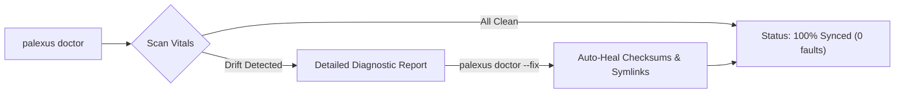
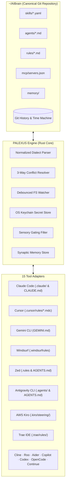

<p align="center">
  <picture>
    <source media="(prefers-reduced-motion: reduce)" srcset="docs/assets/palexus-neon-hero.png">
    
  </picture>
  <br>
  <sub><a href="docs/assets/palexus-neon-hero.mp4">Watch the full-quality reveal (MP4, with sound)</a></sub>
</p>

<div align="center">

<h1>PALEXUS BRAIN</h1>

<b>Clinical Engine · Runtime Gateway</b><br/>
<sub><code>v1.0.0 · 100% LOCAL · MIT</code></sub>

<sub>Dual-Zone Architecture · 15-Tool Star Topology · Zero Telemetry</sub>

</div>

- **System parity:** `[██████████]` 15/15 (100%)
- **Token gating:** `[█████████·]` 93% (-139k)
- **Gateway proxy:** ● `127.0.0.1:8088` (Ollama)
- **Zero telemetry:** ● 0 packets (audited)
- **Star adapters:** 15 active grafts (0 drift)
- **Self-healing:** ● lockstep (0 faults)

<div align="center">

[](https://earnerbaymalay.github.io/palexus/)
[](https://github.com/earnerbaymalay/palexus-brain/actions)
[](packages/e2e/)
[](packages/core/)
[](https://github.com/earnerbaymalay/palexus-brain/releases)
[](LICENSE)
[](https://github.com/earnerbaymalay/palexus-brain)
[](docs/security.md)
[](docs/security.md)
[](https://www.rust-lang.org/)
[](https://v2.tauri.app/)
[](docs/packaging/RELEASE_PACKAGING.md)

**[Live Site](https://earnerbaymalay.github.io/palexus/)** · **[Privacy & Safety](#privacy--safety-by-design)** · **[Quickstart](#tier-1-day-1--60-second-quickstart)** · **[15 Adapters](#15-verified-tool-adapters)** · **[Architecture](#architecture--mental-model)** · **[The Doctor](#tier-2-day-2--care--maintenance)** · **[Gateway & Sensory Gate](#tier-3-day-3--runtime-gateway-sensory-gating--memory)** · **[Memory (`palexus mem`)](#synaptic-memory-palexus-mem)** · **[HUD](#vital-signs-hud-palexus-hud)** · **[Desktop App](#desktop-gui-application)** · **[Docs Hub](docs/README.md)**

---

</div>

## Table of Contents

- [What is PALEXUS?](#what-is-palexus)
  - [Privacy & Safety by Design](#privacy--safety-by-design)
  - [Clinical Operating Identity](#clinical-operating-identity)
- [Tier 1: Day 1 — 60-Second Quickstart](#tier-1-day-1--60-second-quickstart)
  - [Terminal Walkthrough](#terminal-walkthrough)
- [Tier 2: Day 2 — Care & Maintenance](#tier-2-day-2--care--maintenance)
  - [The Doctor: Self-Healing Configurations](#the-doctor-self-healing-configurations)
  - [Continuous Daemon Sync](#continuous-daemon-sync)
  - [Git Time Machine Snapshots & Rollback](#git-time-machine-snapshots--rollback)
- [Tier 3: Day 3+ — Runtime Gateway, Sensory Gating & Memory](#tier-3-day-3--runtime-gateway-sensory-gating--memory)
  - [The Runtime Gateway (`palexus serve`)](#the-runtime-gateway-palexus-serve)
  - [Synaptic Sensory Gating: 95% Token Auto-Compression](#synaptic-sensory-gating-95-token-auto-compression)
  - [Synaptic Memory (`palexus mem`)](#synaptic-memory-palexus-mem)
  - [Vital Signs HUD (`palexus hud`)](#vital-signs-hud-palexus-hud)
- [15 Verified Tool Adapters](#15-verified-tool-adapters)
- [Architecture & Mental Model](#architecture--mental-model)
- [Auto-Bundled Obsidian Session Worklog Skill](#auto-bundled-obsidian-session-worklog-skill)
- [Desktop GUI Application](#desktop-gui-application)
- [Security & Threat Model](#security--threat-model)
- [Multi-Platform Installation](#multi-platform-installation)
- [Test & Verification Metrics](#test--verification-metrics)
- [Documentation Index](#documentation-index)
- [Contributing & License](#contributing--license)

---

## What is PALEXUS?

**PALEXUS** is the local-first configuration engine, runtime proxy, and synchronizer that keeps Claude Code, Cursor, Gemini CLI, Windsurf, Zed, AWS Kiro, Trae IDE, and 8+ other AI coding companions in permanent lockstep.

AI coding tools each invent their own idiosyncratic configuration locations and dialects (`CLAUDE.md`, `.cursorrules`, `.windsurfrules`, `.gemini/settings.json`, `.continue/rules/`, `.kiro/steering/`, `.trae/rules/`). When you refine a skill or update an MCP server in one assistant, your other tools fall out of sync.

**PALEXUS eliminates prompt drift by establishing a single canonical Git-backed Brain (`~/AIBrain`), losslessly projecting your rules across all 15 tools, compressing agent token consumption by 95% with Sensory Gating, and providing an ultra-low-RAM local runtime proxy and live HUD.**

### Privacy & Safety by Design

Your AI tooling config touches every API key and every rule you've written — PALEXUS treats that as something to protect, not collect:

| Guarantee | What it means |
|---|---|
| **100% Local Execution** | Every scan, import, and projection runs on-device. No external API calls, no sync servers, no round-trips. |
| **Zero Telemetry** | No phone-home calls, no usage tracking, no third-party crash reporting — auditable directly in source. |
| **OS Keychain Secrets** | API keys live in `libsecret` / macOS Keychain / Windows Credential Manager. Projected configs only hold `${ENV_VAR}` references — raw secrets are never written to plaintext. |
| **Fully Open Source** | MIT licensed, every line of the Rust core and every adapter auditable on GitHub. |
| **Pre-op Snapshots & Rollback** | Nothing is written without a dry-run preview first, and every change ships with an instant Git undo path. |

Full detail in the **[Security & Threat Model Audit](docs/security.md)**.

### Clinical Operating Identity

A developer's AI tooling environment is treated like a vital clinical system:

- **The Organ**
  - Entity: `~/AIBrain`
  - Description: The single, Git-backed canonical source of truth holding every skill, rule, agent, and MCP server.
- **The Grafts**
  - Entity: **15 Adapters**
  - Description: Lossless bi-directional translators projecting canonical rules into each tool's native dialect.
- **The Surgeon**
  - Entity: `palexus`
  - Description: Accountable for every modification — with dry-run verification, pre-op snapshots, and instant rollbacks.
- **The Doctor**
  - Entity: `palexus doctor`
  - Description: Continuous diagnostic self-healing to detect configuration drift and heal broken symlinks.
- **The Gate**
  - Entity: `palexus serve`
  - Description: Local runtime reverse proxy stabilizing tool-calls and executing live Sensory Gating token compression.
- **The Memory**
  - Entity: `palexus mem`
  - Description: 3-layer progressive retrieval engine (search index, timeline context, full detail) and agent hooks.
- **The Cockpit**
  - Entity: `palexus hud`
  - Description: Zero-RAM terminal cockpit monitoring live token burn, latency, and Brain lockstep.

---

## Tier 1: Day 1 — 60-Second Quickstart

Get your workstation synchronized and calibrated in minutes:

```bash
# 0. Interactive System Onboarding Wizard (Calibrate stack, arch & persona)
palexus onboard

# 1. Discover active AI coding tools on your workstation (read-only)
palexus scan

# 2. Preview and ingest configurations into ~/AIBrain
palexus import --dry-run
palexus import

# 3. Project Brain configurations out to all tools
palexus project
```

### Dual-Zone Master Governance (`PALEXUS.md`)
PALEXUS provisions a unified **Master Governance** prompt stamped with cryptographic integrity verification:
- **Zone 1: Clinical Core (Non-Negotiable)**: Stamped with SHA-256 seal `<!-- PALEXUS-CORE-HASH: <hash> -->`. Enforces universal agent invariants, sensory gating hooks, and safety constraints. Automatically audited and self-healed by `palexus doctor --fix`.
- **Zone 2: User Persona (Fully Customizable)**: Engineering stack preferences (e.g., Rust, TypeScript, Tailwind), architectural patterns (Clean Architecture, DDD), TDD protocols, and custom demeanor.

> [!TIP]
> Run `palexus onboard` to launch the interactive onboarding elicitation wizard. Run `palexus scan` first to inspect discovered tools without modifying files. `palexus import --dry-run` shows you exactly what will enter the Brain before a single file is touched.

### Terminal Walkthrough

```text
$ palexus scan

  PALEXUS · INTAKE                                           7 of 15 present
  ──────────────────────────────────────
  Site   ~

  ●  agy-cli               config detected
  ●  claude-code           config detected
  ●  cursor                config detected
  ●  gemini-cli            config detected
  ●  openai-codex          config detected
  ●  opencode              config detected
  ●  zed                   config detected
  ○  aider                 not present
  ○  cline                 not present
  ○  continue              not present
  ○  github-copilot        not present
  ○  kiro                  not present
  ○  roo-code              not present
  ○  trae                  not present
  ○  windsurf              not present
  ──────────────────────────────────────
  7 of 15 supported tools present.
  Next  palexus import --dry-run

$ palexus import --dry-run

  PALEXUS · INTAKE · DRY RUN                         nothing will be written
  ──────────────────────────────────────
  Site   ~

  ●  agy-cli               11 skills  0 agents  0 mcp servers
  ●  claude-code           1 skill   0 agents  0 mcp servers
  ●  gemini-cli            1 skill   0 agents  0 mcp servers
  ●  cursor                0 skills  0 agents  0 mcp servers
  ──────────────────────────────────────
  16 skills, 1 agent, 0 mcp servers would enter the Brain from 7 tools. Nothing was written.
  Next  palexus import

$ palexus project

  PALEXUS · GRAFT                                                   15 grafts
  ──────────────────────────────────────
  Brain  ~/AIBrain
  Tools  ~

  ●  claude-code           CLAUDE.md stamped · .claude/skills/ projected
  ●  cursor                .cursor/rules/ 14 MDC rules projected
  ●  gemini-cli            GEMINI.md stamped
  ●  zed                   .rules stamped · AGENTS.md projected
  ●  agy-cli               AGENTS.md stamped · .agents/skills/ projected
  ──────────────────────────────────────
  All tools synchronized in 14ms.
  Next  palexus doctor
```

---

## Tier 2: Day 2 — Care & Maintenance

Once your Brain is initialized, use Palexus's care commands to maintain permanent lockstep:

### The Doctor: Self-Healing Configurations

When tool configurations drift, symlinks break, or projection stamps are modified directly, `palexus doctor` diagnoses and repairs the issue automatically:

```bash
# Diagnose configuration drift & broken symlinks
palexus doctor

# Apply automatic remediation
palexus doctor --fix
```



### Continuous Daemon Sync

Keep all tools permanently synchronized as you code. The background daemon watches the Brain and all tool configuration directories, resolving drift with a 3-way merge in real time:

```bash
# Run one-time sync check
palexus sync --once

# Run a one-pass synchronization
palexus sync --once
```

### 4. Continuous Synchronization (Roadmap)
Automatic background daemon synchronization via inotify (`palexus sync --daemon`) is planned in Phase 2. Currently, trigger `palexus sync --once` manually or via pre-commit / build hooks.

### Git Time Machine Snapshots & Rollback

Every change to the Brain is versioned in Git. Create explicit pre-op checkpoints before major refactors, and revert instantly if needed:

```bash
# Take a snapshot checkpoint
palexus snapshot "Pre-refactor: added Rust async skill"

# Revert working tree to any commit
palexus rollback <commit-hash>
```

---

## Tier 3: Day 3+ — Runtime Gateway, Sensory Gating & Memory

For active AI development, Palexus provides a complete local runtime proxy, token compression gate, and semantic context layer.

### The Runtime Gateway (`palexus serve`)

When coding agents (Claude Code, Antigravity CLI, Cursor, Aider) are pointed directly at local models (e.g. Qwen 2.5 Coder, DeepSeek on Ollama/llama.cpp), models often choke on strict tool-calling JSON schemas, hallucinate formatting, or bloat the context window.

`palexus serve` launches a blazing-fast local HTTP reverse proxy (`< 15MB RAM`) on `http://127.0.0.1:8088`:

* **Standard Compatibility**: Implements OpenAI `/v1/chat/completions` and Anthropic `/v1/messages`.
* **Runtime Sensory Gating**: Intercepts prompt payloads, collapsing verbose test logs and compiler outputs to save up to 95% of tokens.
* **Tool-Calling Normalization**: Sanitizes tool schemas and repairs markdown-fenced JSON responses from local models into valid OpenAI `tool_calls`.
* **Zero-Telemetry Audit**: Tracks token savings and latency strictly locally.

```bash
# Start the local gateway pointing to Ollama (default port 8088)
palexus serve \
  --upstream http://localhost:11434 \
  --model qwen2.5-coder:7b

# Point your coding agent to: http://localhost:8088/v1
```

### Synaptic Sensory Gating: 95% Token Auto-Compression

AI coding agents frequently execute verbose CLI commands (`cargo test`, `vitest`, `npm build`) that dump thousands of lines of repetitive noise into the context window.

Palexus Sensory Gating eliminates noise while strictly preserving 100% of errors, stack traces, and compiler diagnostics:

```bash
# Execute arbitrary agent commands with real-time semantic compression
palexus exec -- cargo test --workspace
palexus exec -- pnpm test:e2e
palexus exec -- npm run build

# Stream stdin through the compression filter
cargo test 2>&1 | palexus filter \
  --level aggressive

# Inspect spooled raw execution logs anytime
palexus spool list
palexus spool show <id> --grep "error"
```

- `cargo test --workspace` (237 tests)
  - Raw Context: ~8,400 tokens
  - Palexus Context: **~240 tokens**
  - Token Reduction: **97.1%**
  - Preserved Information: All failure assertions, panic traces, summary line
- `vitest run` (160 tests)
  - Raw Context: ~6,800 tokens
  - Palexus Context: **~210 tokens**
  - Token Reduction: **96.9%**
  - Preserved Information: Failed test names, code frame diffs, runtime stats
- `npm install / build`
  - Raw Context: ~4,500 tokens
  - Palexus Context: **~140 tokens**
  - Token Reduction: **96.8%**
  - Preserved Information: Audit warnings, build errors, asset sizes
- `docker build`
  - Raw Context: ~12,000 tokens
  - Palexus Context: **~420 tokens**
  - Token Reduction: **96.5%**
  - Preserved Information: Step statuses, layer caching flags, compilation errors

### Synaptic Memory (`palexus mem`)

Synaptic Memory gives both agents and humans 3-tier progressive context retrieval without exhausting prompt context windows:

* **Layer 1 (`palexus mem search <query>`)**: Compact, token-costed index of past observations, decisions, and files.
* **Layer 2 (`palexus mem timeline <id>`)**: Chronological surrounding context (before/after) for an observation.
* **Layer 3 (`palexus mem get <id...>`)**: Full high-fidelity details, code diffs, and notes.
* **Agent Lifecycle Hooks (`palexus mem hook <event>`)**: Headless hooks for `session-start`, `prompt`, `post-tool`, and `stop` events.

```bash
# Layer 1: Search index for relevant context
palexus mem search "database migration sqlite"

# Layer 2: View chronological timeline around a specific observation
palexus mem timeline 42 --before 3 --after 3

# Layer 3: Retrieve full detail for specific IDs
palexus mem get 42 43

# Record manual observation
palexus mem observe "Migrated to 15 adapters" \
  --file packages/core/src/adapters/mod.rs
```

### Vital Signs HUD (`palexus hud`)

The **Vital Signs HUD** is a zero-RAM, clinical terminal dashboard for monitoring your active AI workstation in real time:

```text
PALEXUS VITAL SIGNS HUD         v1.0.0
Dual-Zone · 15-Tool Star · Zero-Drift

╭─ RUNTIME GATEWAY (LOCAL PROXY)
│ Status:   ● ONLINE 127.0.0.1:8088
│           [g] halt
│ Upstream: http://127.0.0.1:11434
│ Model:    qwen2.5-coder:7b (12ms)
╰──────────────────────────────

╭─ SENSORY GATING & TOKEN METRICS
│ Requests:       14
│ Raw tokens:     148,200
│ Gated tokens:   8,940
│ Compression:    [▰▰▰▰▰▰▰▰▰▰▰▱]
│                 93% (139,260 saved)
╰──────────────────────────────

╭─ CANONICAL BRAIN (THE ORGAN)
│ Path:     ~/AIBrain
│ Adapters: 15 verified tools
│ Doctor:   [▰▰▰▰▰▰▰▰▰▰▰▰]
│           ✔ LOCKSTEP (0 faults)
╰──────────────────────────────

[s] Sync   [d] Doctor   [p] Project
[g] Gateway   [:] Console   [q] Quit
```

```bash
# Open interactive live refreshing HUD
palexus hud

# Print a single clinical snapshot and exit
palexus hud --once
```

---

## 15 Verified Tool Adapters

Every adapter is verified with boundary, stress, and roundtrip tests in our CI matrix:

- **Claude Code / Desktop**
  - Specification: [Spec](docs/adapters/claude.md)
  - Config Location: `CLAUDE.md`, `.claude/skills/`, `.mcp.json`
  - Format: Markdown, JSON
  - Import Capabilities: Skills, Agents, MCP Servers
  - Projection Dialect: Stamped `CLAUDE.md` + `.claude/`
- **Cursor**
  - Specification: [Spec](docs/adapters/cursor.md)
  - Config Location: `.cursorrules`, `.cursor/rules/*.mdc`
  - Format: MDC Frontmatter
  - Import Capabilities: MDC Rules & Globs
  - Projection Dialect: `.cursor/rules/*.mdc`
- **Gemini CLI**
  - Specification: [Spec](docs/adapters/gemini.md)
  - Config Location: `GEMINI.md`, `.gemini/settings.json`
  - Format: Markdown, JSON
  - Import Capabilities: Rules, Settings
  - Projection Dialect: Stamped `GEMINI.md`
- **Windsurf**
  - Specification: [Spec](docs/adapters/windsurf.md)
  - Config Location: `.windsurfrules`, `.codeium/windsurf/mcp.json`
  - Format: Text, JSON
  - Import Capabilities: Rules & MCP Servers
  - Projection Dialect: Stamped `.windsurfrules`
- **Cline**
  - Specification: [Spec](docs/adapters/cline.md)
  - Config Location: `.clinerules`, `cline_mcp_settings.json`
  - Format: Text, JSON
  - Import Capabilities: Custom Rules & MCP
  - Projection Dialect: Stamped `.clinerules`
- **Roo Code**
  - Specification: [Spec](docs/adapters/roo-code.md)
  - Config Location: `.roomodes`, `.clinerules`
  - Format: JSON, Text
  - Import Capabilities: Mode Rules
  - Projection Dialect: Stamped `.roomodes`
- **Aider**
  - Specification: [Spec](docs/adapters/aider.md)
  - Config Location: `CONVENTIONS.md`, `.aider.conf.yml`
  - Format: Markdown, YAML
  - Import Capabilities: Conventions & Config
  - Projection Dialect: Stamped `CONVENTIONS.md`
- **Continue**
  - Specification: [Spec](docs/adapters/continue.md)
  - Config Location: `.continue/rules/*.md`, `.continue/config.json`
  - Format: MDC, JSON
  - Import Capabilities: MDC Rules & Config
  - Projection Dialect: `.continue/rules/*.md`
- **GitHub Copilot**
  - Specification: [Spec](docs/adapters/github-copilot.md)
  - Config Location: `.github/copilot-instructions.md`
  - Format: Markdown
  - Import Capabilities: Scoped Instructions
  - Projection Dialect: Stamped Instructions
- **Zed**
  - Specification: [Spec](docs/adapters/zed.md)
  - Config Location: `.rules`, `.zed/settings.json`, `AGENTS.md`
  - Format: Text, JSON, MD
  - Import Capabilities: Settings & Rules
  - Projection Dialect: `.rules` + `AGENTS.md`
- **OpenAI Codex CLI**
  - Specification: [Spec](docs/adapters/openai-codex.md)
  - Config Location: `.codex/config.toml`, `.codex/instructions.md`
  - Format: TOML, Markdown
  - Import Capabilities: Rules, Config
  - Projection Dialect: `AGENTS.md` + `.codex/`
- **OpenCode**
  - Specification: [Spec](docs/adapters/opencode.md)
  - Config Location: `AGENTS.md`
  - Format: Markdown
  - Import Capabilities: Multi-Agent Rules
  - Projection Dialect: Stamped `AGENTS.md`
- **Antigravity CLI (AGY)**
  - Specification: [Spec](docs/adapters/antigravity.md)
  - Config Location: `AGENTS.md`, `.agents/skills/`, `.agents/`
  - Format: Markdown, YAML
  - Import Capabilities: Skills & Settings
  - Projection Dialect: `AGENTS.md` + `.agents/skills/`
- **AWS Kiro IDE**
  - Specification: [Spec](docs/adapters/kiro.md)
  - Config Location: `.kiro/steering/*.md`, `.kiro/settings/mcp.json`
  - Format: Frontmatter, JSONC
  - Import Capabilities: Steering Rules & MCP
  - Projection Dialect: `.kiro/steering/` + `.kiro/settings/`
- **Trae IDE**
  - Specification: [Spec](docs/adapters/trae.md)
  - Config Location: `.trae/rules/*.md`, `.trae/mcp.json`
  - Format: MDC Frontmatter, JSONC
  - Import Capabilities: Scoped Rules & MCP
  - Projection Dialect: `.trae/rules/` + `.trae/mcp.json`

---

## Architecture & Mental Model

PALEXUS operates on a star-topology with `~/AIBrain` at the core. Canonical rules, skills, agents, and MCP definitions are parsed into a normalized schema and projected outward via dialect-specific adapters.



---

## Auto-Bundled Obsidian Session Worklog Skill

Every install of PALEXUS comes with the canonical **Obsidian Session Worklog Skill** auto-provisioned inside `~/AIBrain/skills/obsidian-session-worklog/` and projected outward across all tools:

1. **Discovers your Obsidian Vault**: Auto-locates `$OBSIDIAN_VAULT_PATH` or `~/Documents/My-Vault`.
2. **Logs Session Milestones**: Automatically writes session worklogs to `${VAULT}/Worklog/AGY Sessions/YYYY-MM-DD - AI Session - ${CONVERSATION_ID}.md`.
3. **Syncs Project Checklists**: Keeps `${VAULT}/Projects/${PROJECT_NAME}/Repository To-Do.md` in lockstep with completed milestones and git commits.

---

## Desktop GUI 5-Screen Studio

In addition to the high-speed CLI, PALEXUS includes a cross-platform desktop application built with **Tauri v2 + React 18 + Three.js WebGL** and styled with the **PALEXUS Dark Precision Design System** (`#020408` ground, `#00F0FF` cyan accent, sharp geometric borders, zero emojis).

The desktop app implements a 5-screen clinical studio backed directly by `palexus-core` native bindings:
- **Intake**: Interactive elicitation wizard for stack selection, architectural principles, agent demeanor, and canonical Brain status.
- **Examination**: Clinical examination identifying configuration drift, broken projection symlinks, Rule 15 tamper detection, and one-click self-healing.
- **Cockpit**: Real-time vital signs HUD featuring a live green EKG heartbeat canvas monitor, gateway telemetry, latency dials, and Sensory Gating token reduction meters.
- **Memory**: **3D Cybernetic Neural Cinema Engine** — hardware-accelerated Three.js WebGL scene featuring glowing geodesic nodes, tilted gyroscopic orbital rings, curved 3D fiber-optic axons, high-speed traveling action potential sparks, and synthesized Web Audio acoustic resonance.
- **Sensory Spool**: Live side-by-side terminal log inspection comparing raw tool stdout/stderr against compressed gated context (95% token savings).

It is crowned by the **Global Clinical Alert & Action Center**, providing real-time tamper warnings, doctor findings, and one-click `[Heal Vitals (Doctor --fix)]` restoration.

**PALEXUS // 3D Neural Cinema & Clinical Studio** `v1.0.0`

- **Panels:** Intake · Examination · Cockpit · Memory (3D) · Sensory Spool · Heal Vitals
- ● System parity: 100% · adapters 15/15 online
- ● Zone 1 integrity: verified (SHA-256 `d84f…9c`)
- ● Sensory gating: 42% token compression (active)
- ● 3D cinema: 14 clusters · 22 axons · 60 FPS WebGL
- Interactive 3D WebGL neural matrix running

To run the Desktop GUI in development:
```bash
pnpm install
pnpm --filter desktop-app tauri dev
```

---

## Security & Threat Model

PALEXUS is built from the ground up for strict local isolation and zero data leakage:

- **Zero Telemetry**: PALEXUS performs **zero** phone-home calls, usage tracking, or cloud uploads. Everything executes 100% locally.
- **OS Keychain Integration**: API keys and tokens are stored in the OS Keychain (`libsecret` on Linux, Keychain on macOS, Credential Manager on Windows). Projected configs only use `${ENV_VAR}` references—**raw secrets are never written to plaintext files**.
- **Path Traversal Defense**: All adapter write paths are strictly bounded inside designated workspace/brain directories to prevent directory traversal attacks (CWE-22/59/61/74/94/116/367).

Read the full **[Security & Threat Model Audit](docs/security.md)** for details.

---

## Multi-Platform Installation

### 1. Pre-built Release Packages

Download verified release binaries for your operating system from the **[GitHub Releases](https://github.com/earnerbaymalay/palexus-brain/releases)** page:

- **Linux (Ubuntu/Debian)**
  - Package Format: `.deb` / Binary
  - Installation: `sudo dpkg -i palexus_1.0.0_amd64.deb`
- **macOS (Apple Silicon & Intel)**
  - Package Format: `.dmg` / Binary
  - Installation: Open `.dmg` and drag `Palexus` to Applications
- **Windows**
  - Package Format: `.msi` / `.exe`
  - Installation: Run `Palexus_1.0.0_x64_en-US.msi` installer

### 2. Building From Source (Cargo)

```bash
# Install Rust toolchain (1.75+)
curl --proto '=https' --tlsv1.2 \
  -sSf https://sh.rustup.rs | sh

# Clone repository & build
git clone https://github.com/earnerbaymalay/palexus-brain.git
cd palexus
cargo build --release -p palexus

# Binary is available at:
./target/release/palexus --version
```

---

## Test & Verification Metrics

PALEXUS enforces a 100% test pass requirement across all CI tiers:

**Test suite summary**

| Suite | Result |
| :--- | :--- |
| Rust workspace: unit, security & stress (Cargo) | 237/237 passed |
| Sanity Vitest suite | 4/4 passed |
| Tier 1: happy-path feature coverage | 60/60 passed |
| Tier 2: boundary & corner cases | 60/60 passed |
| Tier 3: combinations & state transitions | 24/24 passed |
| Tier 4: real-world workloads & E2E | 12/12 passed |
| **Total combined pass rate** | **397/397 (100%)** |
| Clippy warnings & lints | 0 warnings |

---

## Documentation Index

- **[Docs Hub](docs/README.md)**
  - Description: Centralized documentation navigation & command index
  - Target Audience: All users & contributors
- **[Quickstart Guide](docs/QUICKSTART.md)**
  - Description: Step-by-step setup in under 60 seconds
  - Target Audience: First-time evaluators
- **[User Guide](docs/USER_GUIDE.md)**
  - Description: Day-to-day workflow, daemon sync, memory, and doctor
  - Target Audience: Daily development
- **[Onboarding Journey](docs/ONBOARDING.md)**
  - Description: 4-phase journey from fragmented configs to permanent lockstep
  - Target Audience: Getting started
- **[Architecture Blueprint](docs/ARCHITECTURE.md)**
  - Description: 3-way merge engine, file system watcher & monorepo layout
  - Target Audience: Core engine developers
- **[Adapters Hub](docs/adapters/README.md)**
  - Description: Complete 15-tool matrix and individual adapter specifications
  - Target Audience: Tool dialect reference
- **[Adapter Authoring Guide](docs/ADAPTER_AUTHORING_GUIDE.md)**
  - Description: Step-by-step guide to authoring a new Rust tool adapter
  - Target Audience: Tool integrators
- **[Security & Threat Model](docs/security.md)**
  - Description: Threat model, path traversal defense, and OS Keychain audit
  - Target Audience: Security & compliance
- **[Contributing Guide](docs/development/CONTRIBUTING.md)**
  - Description: PR lifecycle, test requirements & coding standards
  - Target Audience: Open source contributors
- **[Release Packaging](docs/packaging/RELEASE_PACKAGING.md)**
  - Description: Tauri v2 desktop installers (.deb, .dmg, .msi) & scripts
  - Target Audience: Release engineering

---

## Contributing & License

Contributions are warmly welcomed! To get started:

1. Fork the repository on [GitHub](https://github.com/earnerbaymalay/palexus-brain).
2. Read the **[Contributing Guidelines](docs/development/CONTRIBUTING.md)** and **[Adapter Authoring Guide](docs/ADAPTER_AUTHORING_GUIDE.md)**.
3. Run `cargo test --workspace` and `pnpm test` to ensure all tests pass.
4. Submit a Pull Request.

This project is licensed under the **MIT License** — see the [LICENSE](LICENSE) file for details.

<div align="center">
<sub>Built with Rust, Tauri 2, and React. Zero telemetry. Offline first.</sub>
</div>
