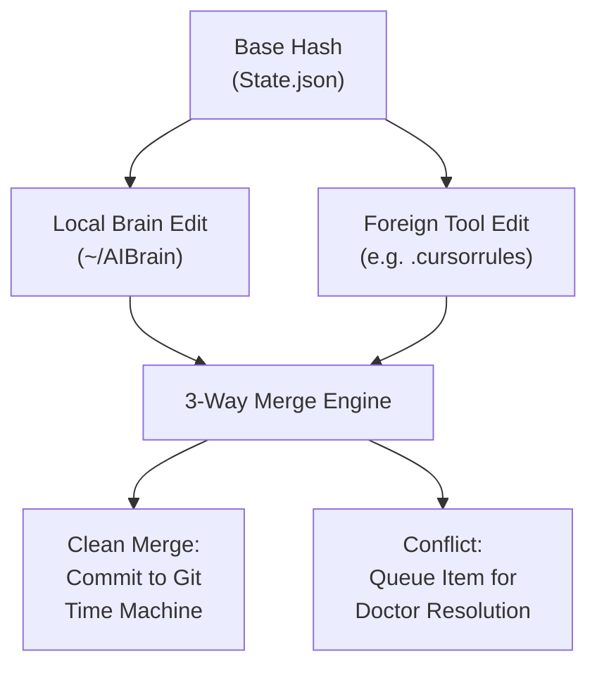

# 🏛️ Architecture & Engine Internals
### Palexus

[Docs Hub](README.md) > **Architecture**

This document describes the architectural layout, core Rust engine components, 3-way merge algorithm, and IPC communications of **Palexus**.

---

## 🏗️ Monorepo Component Layout

```text
Palexus/
├── apps/
│   ├── cli/
│   └── desktop/
├── packages/
│   ├── core/
│   ├── e2e/
│   └── schema/
├── docs/
└── .ai/
```

- `apps/cli/` — Rust CLI entry point (`palexus`)
- `apps/desktop/` — Tauri 2 + React TS Dark Precision GUI
- `packages/core/` — Core engine: scanner, 13 adapters, projector, sync, doctor
- `packages/e2e/` — Vitest E2E integration test suites (Tiers 1-4)
- `packages/schema/` — JSON Schema specifications for skills & agents
- `docs/` — Public documentation & GitHub Pages landing site
- `.ai/` — Internal prompt scratchpads & development history

---

## 🔄 3-Way Merge & Sync Daemon Engine



---

[⬅️ Back to Docs Hub](README.md)
