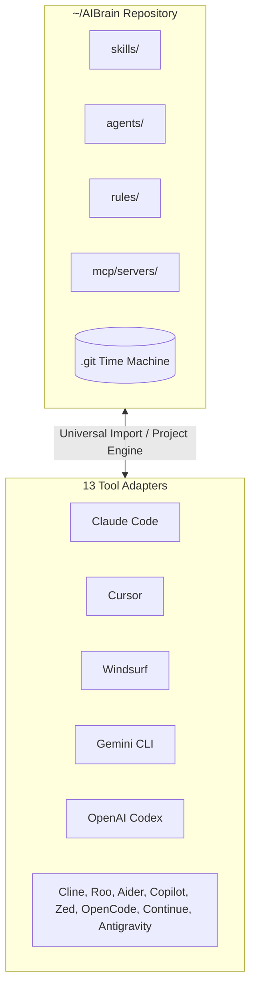
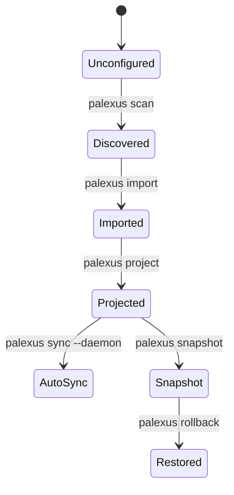
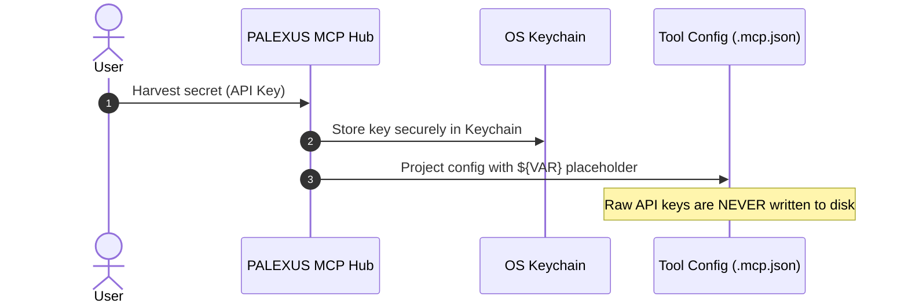
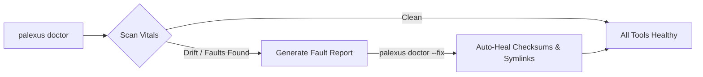

# PALEXUS User Guide
### The Clinical Engine for AI Context — One Brain. All Models.

Welcome to the **PALEXUS** User Guide. This document provides a complete reference for managing your AI coding tool configurations using the `palexus` CLI and the React desktop application.

---

## Table of Contents

1. [Core Concepts](#1-core-concepts)
2. [CLI Command Reference](#2-cli-command-reference)
   - [palexus scan](#palexus-scan)
   - [palexus import](#palexus-import)
   - [palexus project](#palexus-project)
   - [palexus sync](#palexus-sync)
   - [palexus doctor](#palexus-doctor)
   - [palexus snapshot & rollback](#palexus-snapshot--rollback)
   - [palexus backups & undo](#palexus-backups--undo)
   - [palexus exec & filter](#palexus-exec--filter-synaptic-auto-compression)
   - [palexus spool](#palexus-spool)
   - [palexus serve](#palexus-serve-runtime-gateway)
   - [palexus mem](#palexus-mem-3-layer-context-retrieval)
   - [palexus hud](#palexus-hud-vital-signs-cockpit)
3. [Supported Tool Adapters (15/15)](#3-supported-tool-adapters-1515)
4. [Desktop GUI Application](#4-desktop-gui-application)
5. [MCP Hub & OS Keychain Integration](#5-mcp-hub--os-keychain-integration)
6. [Doctor Diagnostic Engine](#6-doctor-diagnostic-engine)
7. [Troubleshooting & FAQ](#7-troubleshooting--faq)

---

## 1. Core Concepts

PALEXUS unifies configuration management across all AI tools installed on your system using a single, Git-backed directory — **the Brain** (`~/AIBrain`).



> [!NOTE]
> **The Three-Command Loop:**  
> `palexus scan` → `palexus import` → `palexus project`.  
> Once imported into `~/AIBrain`, use `palexus sync --daemon` to keep every tool automatically in lockstep.

### Inbuilt Obsidian Session Worklog Skill
Every freshly initialized or imported Brain automatically provisions the canonical `obsidian-session-worklog` skill into `~/AIBrain/skills/obsidian-session-worklog/` and projects it across all tools:
- **Automatic Vault Discovery**: Locates `$OBSIDIAN_VAULT_PATH` or fallback `~/Documents/My-Vault`.
- **Session Worklog Tracking**: Standardized markdown note creation at `${VAULT}/Worklog/AGY Sessions/YYYY-MM-DD - AI Session - ${CONVERSATION_ID}.md`.
- **Cross-Tool Projection**: Projected as `.claude/skills/`, `.cursor/rules/`, `.agents/skills/`, and `.continue/rules/` across all 13 coding assistants.

---

## 2. CLI Command Reference

Both binary names `palexus` and `palexus` can be used interchangeably.



### `palexus scan`
Discovers all AI coding tools installed across your home directory and active workspace.

```bash
palexus scan
```

### `palexus import`
Losslessly ingests tool configs into `~/AIBrain`. Always run with `--dry-run` first to preview changes.

```bash
palexus import --dry-run
palexus import
```

> [!TIP]
> `palexus import --dry-run` produces zero disk writes and displays a structured preview of skills, agents, rules, and MCP servers to be ingested.

### `palexus project`
Pushes Brain configurations out to the tools you have installed. Generates symlinks where supported, or stamped files marked `<!-- GENERATED BY Palexus — edit in the Brain -->`.

A tool counts as installed when its config is found in the tools folder: your home folder, or `--tool-root`, `$PALEXUS_WORKSPACE_PATH` or `$PALEXUS_TOOL_ROOT` if set. The folder you run the command from is never used, so the CLI and the desktop app always look at the same files. Tools that are not installed get nothing, except a skill whose `targets` names them explicitly. `--dry-run` lists what each tool would get and writes nothing.

```bash
palexus project --dry-run
palexus project
```

### `palexus sync`
Starts background lockstep monitoring or executes a one-time reconciliation.

```bash
# One-time sync
palexus sync --once

# Background daemon watcher
palexus sync --daemon
```

### `palexus doctor`
Diagnoses configuration drift, broken symlinks, or missing projections across all 13 tools.

```bash
# Health report
palexus doctor

# One-command auto-repair
palexus doctor --fix
```

### `palexus snapshot & rollback`
Marks deliberate history points in your Brain Git repository or restores working tree state.

```bash
# Take Git snapshot
palexus snapshot "Added Rust refactoring skill"

# Revert to snapshot revision
palexus rollback <commit-hash>
```

### `palexus backups & undo`
A snapshot covers the Brain only. `project`, `sync`, `doctor --fix` and `onboard` also change files that belong to your tools. So before a file is overwritten, Palexus saves the original under `~/AIBrain/.brain/backups/<id>/` and prints the id. If the original can't be saved, the file is not written. A run that changes nothing leaves no backup. Backups are kept out of Brain snapshots, and a rollback leaves them alone.

```bash
# List saved copies, newest first
palexus backups

# Put back the newest change not yet undone (files it created are removed)
palexus undo

# Or a specific one
palexus undo <id>
```

### `palexus exec & filter` (Synaptic Auto-Compression)
Executes arbitrary terminal commands or streams with intelligent sensory gating—reducing agent token consumption by ~95% while strictly preserving errors and stack traces.

```bash
# Wrap command execution with real-time semantic compression
palexus exec -- cargo test --workspace
palexus exec -- pnpm test:e2e
palexus exec -- pytest tests/

# Pipe standard input through the compression filter
cargo test 2>&1 | palexus filter \
  --level aggressive
```

### `palexus spool`
Inspects, searches, or replays the local raw uncompressed execution logs.

```bash
# List all cached execution logs and token reduction ratios
palexus spool list

# Display full uncompressed log or filter by pattern
palexus spool show <id>
palexus spool show <id> --grep "panic"
palexus spool show <id> --tail 50
```

### `palexus serve` (Runtime Gateway)
Starts a local HTTP reverse proxy (`< 15MB RAM`) that intercepts OpenAI `/v1/chat/completions` and Anthropic `/v1/messages` requests from coding agents (Claude Code, Antigravity CLI, Cursor, Aider). Automatically prunes bloated token payloads with Sensory Gating and enforces valid JSON tool-calling structures when routing to local models (Ollama, llama.cpp).

```bash
# Start gateway proxying to local Ollama instance on port 8088
palexus serve --port 8088 \
  --upstream http://localhost:11434 \
  --model qwen2.5-coder:7b

# Run with aggressive Sensory Gating compression level
palexus serve --gate-level aggressive
```

### `palexus mem` (3-Layer Context Retrieval)
Synaptic Memory gives agents and humans 3-tier progressive context retrieval without blowing up prompt context windows:

* **Layer 1 (`palexus mem search <query>`)**: Compact, token-costed index of past observations, decisions, and files.
* **Layer 2 (`palexus mem timeline <id>`)**: Chronological surrounding context (before/after) for an observation.
* **Layer 3 (`palexus mem get <id...>`)**: Full high-fidelity details, code diffs, and notes.
* **Agent Lifecycle Hooks (`palexus mem hook <event>`)**: Seamless hooks for `session-start`, `prompt`, `post-tool`, and `stop` events.

```bash
# Layer 1: Search index for relevant context
palexus mem "database migration sqlite"

# Layer 2: View chronological timeline around a specific observation
palexus mem timeline 42 --before 3 --after 3

# Layer 3: Retrieve full detail for specific IDs
palexus mem get 42 43

# Record manual observation
palexus mem observe "Migrated to 15 adapters" \
  --file packages/core/src/adapters/mod.rs
```

### `palexus hud` (Vital Signs Cockpit)
Launches the zero-RAM terminal cockpit HUD displaying live gateway connectivity, token burn rate, Sensory Gating compression percentages, upstream latency, and canonical `~/AIBrain` doctor health diagnostics.

```bash
# Open interactive live refreshing HUD
palexus hud

# Print single clinical snapshot and exit
palexus hud --once
```

---

## 3. Supported Tool Adapters (15/15)

- **Claude Code / Desktop**
  - Native Config Locations: `CLAUDE.md`, `.claude/skills/`, `.claude/agents/`, `.mcp.json`
  - Import Strategy: Full skills & agents parsing
  - Projection Output: Dedicated `.claude/` structure
- **Gemini CLI**
  - Native Config Locations: `GEMINI.md`, `.gemini/settings.json`
  - Import Strategy: Rules & settings
  - Projection Output: Stamped `GEMINI.md`
- **OpenAI Codex CLI**
  - Native Config Locations: `.codex/config.toml`, `.codex/instructions.md`
  - Import Strategy: Multi-agent rules
  - Projection Output: `AGENTS.md` + `.codex/`
- **Cursor**
  - Native Config Locations: `.cursorrules`, `.cursor/rules/*.mdc`
  - Import Strategy: MDC frontmatter globs
  - Projection Output: `.cursor/rules/` MDC files
- **Windsurf**
  - Native Config Locations: `.windsurfrules`, `mcp_config.json`
  - Import Strategy: Rules & MCP servers
  - Projection Output: `.windsurfrules`
- **Cline**
  - Native Config Locations: `.clinerules`, `cline_mcp_settings.json`
  - Import Strategy: Custom rules & servers
  - Projection Output: `.clinerules`
- **Roo Code**
  - Native Config Locations: `.roomodes`, `.clinerules`
  - Import Strategy: Mode rules
  - Projection Output: `.roomodes`
- **Aider**
  - Native Config Locations: `CONVENTIONS.md`, `.aider.conf.yml`
  - Import Strategy: Conventions & YAML
  - Projection Output: `CONVENTIONS.md`
- **Continue**
  - Native Config Locations: `.continue/rules/*.md`, `.continue/config.json`
  - Import Strategy: MDC rules & JSON
  - Projection Output: `.continue/rules/`
- **GitHub Copilot**
  - Native Config Locations: `.github/copilot-instructions.md`
  - Import Strategy: Scoped instructions
  - Projection Output: `.github/copilot-instructions.md`
- **Zed**
  - Native Config Locations: `.rules`, `.zed/settings.json`, `AGENTS.md`
  - Import Strategy: Settings & rules
  - Projection Output: `.rules` + `AGENTS.md`
- **OpenCode**
  - Native Config Locations: `AGENTS.md`
  - Import Strategy: Multi-agent rules
  - Projection Output: `AGENTS.md`
- **Antigravity CLI**
  - Native Config Locations: `AGENTS.md`, `.agy/skills/`, `.gemini/settings.json`
  - Import Strategy: Skills & settings
  - Projection Output: `AGENTS.md` + `.agy/skills/`
- **AWS Kiro IDE**
  - Native Config Locations: `.kiro/steering/*.md`, `.kiro/settings/mcp.json`
  - Import Strategy: Steering rules & MCP
  - Projection Output: `.kiro/steering/` + `.kiro/settings/`
- **Trae IDE**
  - Native Config Locations: `.trae/rules/*.md`, `.trae/mcp.json`
  - Import Strategy: Scoped rules & MCP
  - Projection Output: `.trae/rules/` + `.trae/mcp.json`

---

## 4. Desktop GUI Application

The Tauri v2 Desktop GUI provides a clinical operating console built with the **PALEXUS Dark Precision Design System** (`#06080b` ground, `#1d9bf0` palexus accent, sharp geometric borders, zero emojis).

The desktop app implements two measured screens backed directly by `palexus-core` native bindings:
- **Intake**: Live inspection of discovered AI tools, installed rules, active skills, and canonical Brain status.
- **Examination**: Clinical examination identifying configuration drift, broken projection symlinks, and fault diagnosis.

**PALEXUS // Clinical Engine for AI Context** `v1.0.0`

- **Sidebar:** Intake · Examination · [re-read]
- **Intake report**
  - Canonical Brain: `~/Desktop/AI BRAIN`
  - Adapters discovered: 15 active targets
  - Lockstep health: ● synchronized (0 faults)

---

## 5. MCP Hub & OS Keychain Integration

PALEXUS manages Model Context Protocol (MCP) servers across all tools with built-in OS Keychain secret resolution.



> [!IMPORTANT]
> Raw API tokens and credentials are never stored in plaintext config files. All projected MCP configs reference variables as `${ENV_KEY}`, resolving keys from the OS Keychain at execution time.

---

## 6. Doctor Diagnostic Engine

The Doctor engine continuously monitors your machine for configuration drift, orphaned symlinks, and broken projections.



---

## 7. Troubleshooting & FAQ

> [!CAUTION]
> **Modifying Projected Files:**  
> Never edit projected files directly (e.g. `CLAUDE.md` stamped with generated headers). Always make edits inside `~/AIBrain` — the auto-sync daemon will project your changes automatically.

### Common Questions

- **Where is my Brain located?**  
  By default, the Brain is stored at `~/AIBrain`. You can override this location by setting `AIBRAIN_PATH=/your/custom/path`.
- **How do I roll back a bad configuration edit?**  
  Run `palexus rollback HEAD~1` to restore the previous Git snapshot of your Brain working tree.
- **A Palexus command overwrote a tool file I had edited by hand. Can I get it back?**  
  Yes. `palexus undo` puts back the files the last command changed, and `palexus backups` lists earlier ones.

---

**Next Steps:** Read [docs/ONBOARDING.md](ONBOARDING.md) for the 4-phase quickstart walkthrough or [docs/ADAPTER_AUTHORING_GUIDE.md](ADAPTER_AUTHORING_GUIDE.md) to author a new tool adapter in Rust.
